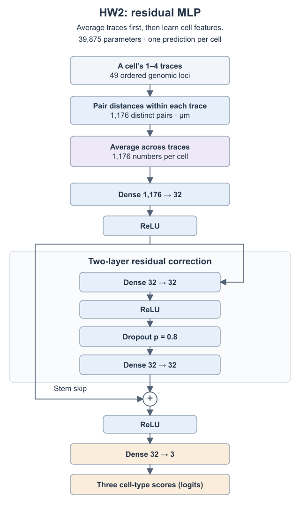
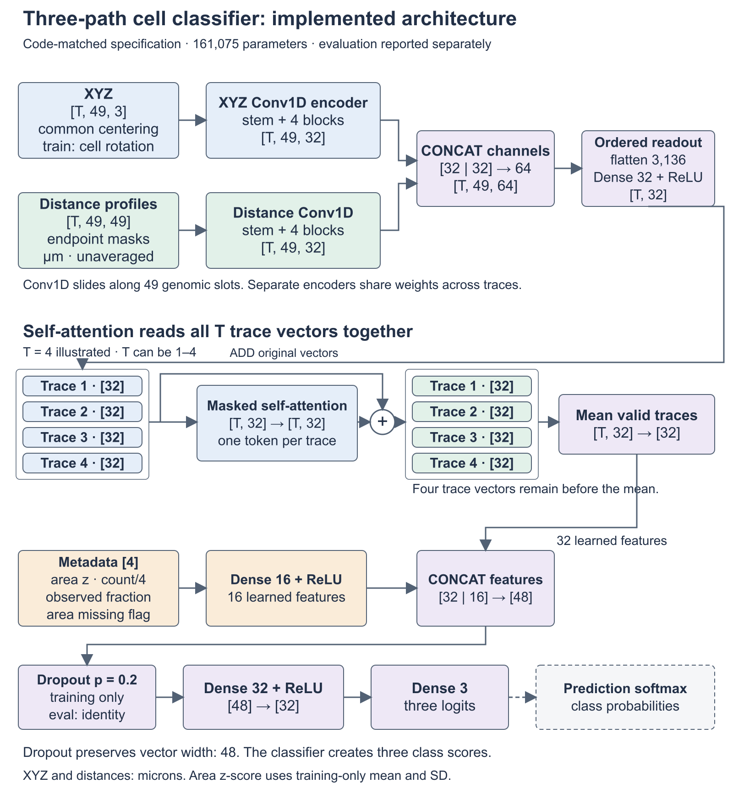
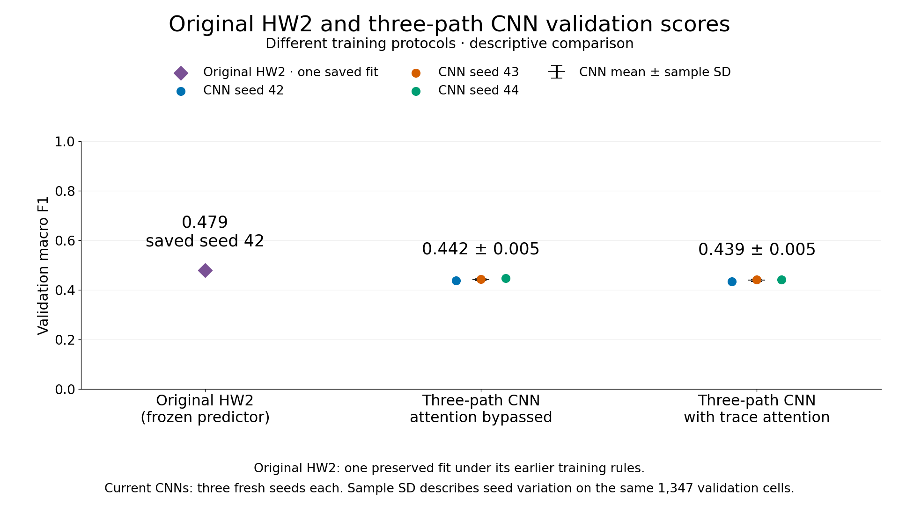
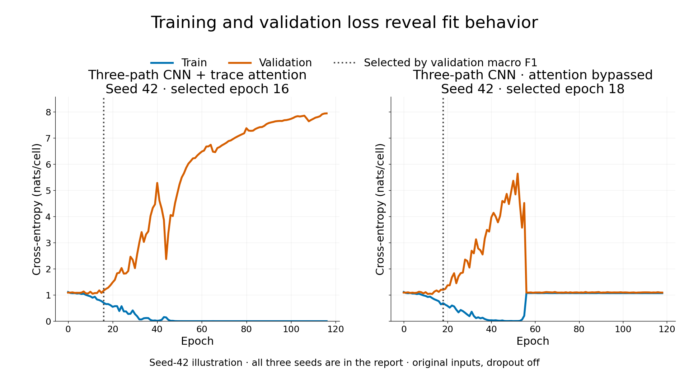

# HW3: three input paths before trace attention

This repository contains the HW1 chromosome viewer, the HW2 cell-type predictor,
and the HW3 architecture experiment. **The HW3 redesign did not improve validation
macro F1:** the three-path CNN scored 0.439 with attention and 0.442 with attention
bypassed, compared with the original HW2 result of 0.479. The web API retains the
frozen HW2 predictor. The Models tab explains the HW3 design and results.

HW3 submission materials: [2:55 narrated video](docs/hw3/HW3-Video.mp4) and
[two-page summary](docs/hw3/report.pdf). The video includes an on-screen correction:
the CNN without attention scored **0.442 macro F1**.

## 1. Task and dataset

The prediction task distinguishes Hepatocyte, Erythroblast and Proerythroblast cells
using FOF-CT spatial measurements of mouse chromosome 19. The fixed HW3 cohort has
2,439 training cells from biological replicates 1–2 and 1,347 validation cells from
replicate 3. Each cell contains one to four traces at 49 ordered genomic loci.
Replicate-4 coordinates are outside the HW3 experiment. Source data are described
in the [application reference](#type-of-data-being-visualized) below.

Coordinate and distance masks retain missing-measurement information. They do not
repair bad measured coordinates or reconstruct DNA between measured loci. Private
research tables and derived input caches are excluded from this repository. The
committed three-cell viewer sample supports the app and frozen HW2 prediction;
training the full HW3 experiment requires authorized access to the inputs below.

## 2. HW2 baseline architecture

The final HW2 residual multilayer perceptron has 39,875 parameters. Each cell supplies
1,176 within-trace pairwise distances averaged across its traces. A 1,176→32 ReLU
stem feeds a 32→32→32 branch with dropout 0.8. An identity addition and ReLU precede
the 32→3 classifier. The primary baseline is the original frozen seed-42 validation
macro F1 of **0.479058**.



The [baseline record](docs/hw3/step-1-baseline.md) describes its training procedure,
cross-entropy objective, metric and evidence of learning. Its
[implementation](training/final_model.py) and
[frozen model records](training/results/three_class_residual_f1_v1/) are preserved.

## 3. Proposed modification and rationale

My hypothesis was that encoding each trace before combining traces would retain
folding differences and relative spatial placement that early averaging can hide.
The design gives XYZ, pairwise distances and metadata distinct roles:

- XYZ uses one shared observed-point center. Training rotates all traces in a cell
  together, retaining their relative positions while varying orientation.
- Pairwise-distance profiles retain each trace separately in microns and expose
  rotation-invariant folding directly.
- Metadata contains training-standardized cell area, valid-trace count divided by
  four, observed-point fraction and an area-missing flag.

The XYZ and distance branches each have one width-three Conv1D stem and four
repeated residual blocks, with two width-three convolutions per block: nine
convolutions per encoder. Each encoder follows genomic order and shares its
weights across traces, with separate weights for XYZ and distances. The maximum
local convolutional receptive field spans 19 retained positions before the global
ordered readout. Genomic spacing between retained positions remains unequal.

Corresponding outputs concatenate into 64 features per locus. Ordered flattening
and a 3,136→32 projection create one vector per trace. One masked self-attention
layer lets valid trace summaries exchange information; an identity skip preserves
the original vectors before the valid-trace mean. A 4→16 metadata layer joins the
32 geometry features by concatenation, producing 48 features. Dropout 0.2 and a
48→32 ReLU→3 head produce class scores. The model has **161,075 parameters**.



[Zoomable architecture](docs/hw3/architecture/proposal-three-path-attention/overview.svg) ·
[Residual blocks, attention and feature joins](docs/hw3/architecture/proposal-three-path-attention/detail.svg) ·
[Model source](research/hw3-three-path-2026-11-09/model.py)

This combines small-kernel stacking, parallel processing and
[residual learning](https://arxiv.org/abs/1512.03385) with
[attention over sets](https://proceedings.mlr.press/v97/lee19d.html).
More depth increases capacity and can worsen overfitting. Distances overlap with
XYZ information; metadata can reflect assay coverage or segmentation. The ordered
32-value trace summaries compress locus-level information before attention. The
[component rationale](docs/hw3/video-script.md#component-rationale-for-rehearsal-and-questions)
explains each choice and its possible failure.

## 4. Running the experiments

The experiment compares the complete model with an attention-bypass ablation,
using seeds 42, 43 and 44. Both arms have the same initial weights within each seed,
data, encoders, metadata, SGD learning rate 0.01, momentum 0.9, batch size 64,
maximum 1,000 epochs and patience 100. Two cross-entropies are averaged for each
batch: one original view and one common whole-cell XYZ rotation. Distances and
metadata remain unchanged. Validation is unaugmented with dropout disabled.
Macro F1 selects the checkpoint; only a strict gain resets patience. Lower loss
breaks equal-F1 ties, and epoch zero is eligible. Training uses unweighted
cross-entropy; macro F1 gives each class equal evaluation weight.

The [configuration](research/hw3-three-path-2026-11-09/training_config.json) pins
three authorized input caches by SHA256:

```text
research/hw3-observed-geometry-2026-11-09/observed.npz
6cac54798b0d6747b63c75bd998c6d59eee74cffb398c72b130e1b3382afc77e

research/hw3-architecture-pilot-2026-11-02/inputs.npz
436ef34efd13c1b11ad761b4b80ed1fdf5290fc13fd5dcbb748683ff367dc398

research/retry-three-class-2026-10-28/coordinates/provenance/inputs.npz
2662c8ce76d96ed0002046e031393ee09e3179b647610cebe0dc00a5c8b13ea7
```

The observed cache contains coordinates and masks. The other two establish exact
HW2 cohort and input equality. These inputs require authorized data access. The
historical raw-table-to-cache preparation chain requires local path configuration
and is not presented as a portable preprocessing pipeline.

Use Python with PyTorch, NumPy, pandas, SciPy and scikit-learn. The recorded GPU
runtime was Python 3.12.3, Torch `2.12.0a0+0291f960b6.nv26.04.48445190`, NumPy 2.1.0
and scikit-learn 1.8.0 on an NVIDIA RTX A6000. Local model checks also ran under
Torch 2.11.0. From the repository root, with the required caches present:

```sh
python -m unittest discover -s research/hw3-three-path-2026-11-09 -p 'test_model.py' -v
python research/hw3-three-path-2026-11-09/train.py \
  --condition attention --seed 42 --threads 1 --device cuda \
  --output research/hw3-three-path-2026-11-09/results/attention/seed42
```

Repeat for seeds 43 and 44 and for `--condition no_attention`, changing the output
folder to match. Each condition/seed owns its output folder. The full fits were
run independently in parallel, with one GPU, two allocated CPUs and one numerical
CPU thread per fit. A three-hour allocation provided margin; actual fits took
about 249–298 seconds. See the [experiment instructions](research/hw3-three-path-2026-11-09/README.md)
for panel and analysis commands. Saved histories, checkpoints and cell-level
predictions remain local; public results contain aggregate scores and curves.

A portable six-fit GPU array is included. With the required caches, an active
Python environment and a GPU allocation account, submit from the repository root:

```sh
sbatch --account=YOUR_ACCOUNT research/hw3-three-path-2026-11-09/native/run-panel.slurm
```

Wait for all six rows to complete successfully, then check and aggregate their
locally saved predictions:

```sh
python research/hw3-three-path-2026-11-09/analyse.py \
  --results research/hw3-three-path-2026-11-09/results \
  --output research/hw3-three-path-2026-11-09/report
```

The analyzer checks completion hashes, original targets and predictions, class
metrics, cross-entropy and selected epochs for the six CNN fits. The committed
summary also records a separately completed, training-matched HW2 diagnostic.
The public summary and CSVs can be inspected without the private inputs or local
prediction arrays.

The original HW2 fit used zero momentum, one forward per batch, maximum 2,000
and patience 200. A secondary reference reuses three HW2 fits under the same
optimizer, batch, two-forward loss, cap and patience as HW3. Its dense interpolated
representation and dropout 0.8 remain intact. This controls training settings,
while representation differences still prevent an architecture-only causal claim.

To reproduce that secondary diagnostic, use the isolated
[HW2 reference trainer](research/hw3-three-path-2026-11-09/train_hw2_reference.py)
and its [configuration](research/hw3-three-path-2026-11-09/hw2_reference_config.json):

```sh
python research/hw3-three-path-2026-11-09/train_hw2_reference.py \
  --seed 42 --device cuda --threads 1 \
  --output research/hw3-three-path-2026-11-09/results/hw2_reference/seed42
```

Repeat with seeds 43 and 44 in separate output folders. Each fit saves its
validation metrics and training history. The
[recorded three-seed table](research/hw3-three-path-2026-11-09/report/hw2-reference-per-seed.csv)
distinguishes selected-checkpoint scores from final-epoch losses. The reference
averages two stochastic dropout forwards of the same dense input per batch;
rotation leaves these pairwise-distance inputs unchanged.

## 5. Main results

| Model | Validation macro F1 | Mean GPU fit time |
| --- | ---: | ---: |
| Original frozen HW2, seed 42 | 0.479058 | Not remeasured |
| Three-path CNN, attention bypassed | 0.4420 ± 0.0049 | 249.5 s |
| Three-path CNN with trace attention | 0.4390 ± 0.0051 | 291.0 s |

CNN values are means ± sample standard deviations across three seeds on the same
validation cells. The HW2 row is one frozen run. All six new fits completed under
the declared stopping rule, restored their selected checkpoints, and passed
prediction and source checks. Replaying all six selected GPU checkpoints reproduced
both splits' logits bitwise. Fit times exclude the queue; full-fit peak memory was
not measured. Seed variation does not measure biological-replicate uncertainty.



Attention-minus-bypass macro-F1 differences were −0.00396, −0.00048 and −0.00484,
with mean −0.00309. All were negative, although this small comparison does not
establish a general harmful effect. Mean Proerythroblast F1 decreased from 0.3842
to 0.3663; Hepatocyte and Erythroblast means rose slightly.

The secondary training-matched HW2 reference scored 0.2064 ± 0.0429, averaging
37.8 seconds per fit. It failed to learn useful classification under this regime.
Two seeds selected epoch zero, and final training loss remained near 1.08. Its low
score does not establish improvement over the original HW2 model.

The [experiment results](research/hw3-three-path-2026-11-09/report/) include
per-seed and per-class aggregate tables, training curves and confusion counts.
The [separate two-page report](docs/hw3/report.pdf) distinguishes the hypothesis
from observations. Its [Markdown source](docs/hw3/report.md) and the
[explanation script](docs/hw3/video-script.md) are also included.

## 6. What I learned

The hypothesis was unsupported. Five fits ended with low training loss and high
validation loss. Attention selected checkpoints at epochs 11–16, before its final
training F1 reached 0.993–1.000 and validation cross-entropy reached 3.47–7.95.
The bypass also overfit, but seed 42 additionally lost training fit late: its loss
rose from 0.0049 at epoch 50 to about 1.07 by epoch 56. The earlier selected
checkpoint remains the evaluated predictor.



The larger model can fit more variation, but added capacity, coordinate noise,
weaker dropout and replicate shift remain competing explanations. Their individual
effects were not isolated. All supplied areas were observed, so the area-missing
flag supplied no variation. Attention weights and metadata contributions have no
independent biological interpretation here.

My next controlled experiment would reduce encoder depth while keeping inputs,
attention and training fixed. If the training–validation gap shrank without losing
validation F1, that would support excess capacity as one explanation. A later
metadata ablation could test reliance on assay coverage. Repeated use of one
validation replicate limits generalization claims. The frozen HW2 model remains
the application predictor because this redesign supplied no validation improvement.

---

## Application and HW2 reference

A web application for viewing fluorescence-in-situ chromosome tracing (FOF-CT)
spots on mouse chromosome 19, with a trained neural network that predicts three cell
types from chromosome distances. The Viewer tab is a gallery of cells. Click a
tile to open one cell as a 3D Plotly scene. The Notebook tab and each cell
page store text notes, per-trace notes, per-locus TAD notes,
and an optional pinned locus in SQLite through FastAPI.

### Type of data being visualized

Imaged loci on chromosome 19. Each spot has `Spot_ID`, `Trace_ID`, `X`, `Y`,
`Z` (microns), genomic start and end, and `Cell_ID`. Spots that share a
`Trace_ID` are one trace. When the local catalog is present, the
gallery covers 13,306 labeled cells across four biological replicates
(biorep01–04). A clone without that catalog loads the committed sample cells
411, 328, and 530. The replicate 1 coordinates are the 4DN file
[4DNFIQCHBYZ6](https://data.4dnucleome.org/files-processed/4DNFIQCHBYZ6/),
reported in Liu et al.,
[Multiplexed imaging of nucleome architectures in single cells of mammalian tissue](https://pubmed.ncbi.nlm.nih.gov/32518300/)
(Nature Communications, 2020).

### Project organization

- `frontend/`: React application and browser sample files.
- `backend/`: FastAPI application and local annotation database.
- `training/results/three_class_residual_f1_v1/`: frozen model weights, cleaning protocol, settings and evaluation.
- `data/`: local source tables, excluded from Git.
- `training/`: shared model, features, training, evaluation and recorded results.
- `scripts/`: catalog building and sample-shape fitting utilities.

The model is connected to the Viewer and the **Train & monitor** tab.
[training/README.md](training/README.md) maps the seven training steps to code and checks.
[Training details](training/README.md) describe the comparison and reproduction commands.

### Instructions for running the application

The verified API runs in Docker with Python 3.12 and CPU PyTorch 2.11.0.
The React app needs Node.js 20.19+ in the 20.x line, or 22.12+ (`node -v`). Run the following
from a copy containing the entire `training/results/three_class_residual_f1_v1/` folder.
The Docker image needs its weights, baseline weights, metadata, requirements, metrics,
history, validation-exploration summary and freeze record. Raw source data stay outside it.

1. Start Docker Desktop.
2. In the repository root: `docker compose up --build`
3. In another terminal: `cd frontend`
4. `npm install`
5. `npm run dev`
6. Open `http://localhost:5173/`

Vite proxies `/api` to `http://127.0.0.1:8000` (the FastAPI container). Leave
both running. The sample under `frontend/public/sample/` is enough for a clone to
show cells and request predictions for quality-passing cells, with the saved model files above.
Open **Viewer**, select a cell and click **Predict cell type**. The recorded label,
predicted type, uncalibrated model score and model version are shown separately.
Prediction uses all measured spots, including traces hidden in the plot.

The full catalog is gitignored. To rebuild it from local tables:

`python3 scripts/build_viewer_catalog.py`

That writes `frontend/public/catalog.json` and per-cell JSON under
`frontend/public/biorep01/` through `biorep04/`. Do not commit those catalog files,
`data/`, or `backend/data/` (the SQLite file).

#### Local data for training and the complete gallery

The committed sample contains cells 411, 328 and 530. Interactive training requires
these original local files at exactly these paths:

| File | Use |
| --- | --- |
| `data/raw/biorep01/4DNFIQCHBYZ6.csv` | Training coordinates, replicate 1. |
| `data/raw/biorep02/4DNFIA855FW4.csv` | Training coordinates, replicate 2. |
| `data/raw/biorep03/4DNFIY3XDBW8.csv` | Validation coordinates, replicate 3. |
| `data/labels/Cell label.csv` | Recorded cell labels, selected by replicate and cell. |
| `data/labels/cell_type_mapping.csv` | Named cell-type mapping. |

The frozen model and benchmark comparison additionally used
`data/raw/biorep04/4DNFI593PAKT.csv` for its held-out test. Rebuilding the full gallery
uses all four coordinate files. The practice trainer reads coordinate replicates 1–3
and never reevaluates replicate 4. Missing or changed source files produce a visible
error. There is no substitute training dataset.

Docker Compose mounts `./data` read-only at `/app/data`. Annotation storage is
`backend/data/annotations.db`. Separate practice outputs go to `backend/training-runs/`.
The source tables, database and generated practice runs stay outside Git. The supplied
three-cell sample supports viewing and prediction without the full source tables.

#### Train & monitor

Open **Train & monitor**, choose an epoch count and dropout probability, and start
a separate practice model with the selected architecture. The control lets you try
other probabilities without replacing the evaluated model or its test records.
One practice run is admitted at a time. Each epoch publishes real train/validation
loss and macro F1 to the live charts. The frozen results table includes macro F1
and accuracy for train/validation/test.

Dropout randomly zeros hidden values during training and rescales retained values.
Evaluation disables it. A practice choice is an experiment, not evidence of a better
frozen model. Practice output folders preserve chosen settings and their own results.
The **Frozen evaluated model** table separately shows recorded train/validation/test
metrics. The selected-cell prediction continues to use the frozen predictor.
Live job state resets with the API. Keep its configured single worker.

### Major libraries / frameworks

- React 19
- Vite 8
- Plotly (`react-plotly.js` and `plotly.js-dist-min`)
- FastAPI and Pydantic for request validation, served by Uvicorn
- SQLite
- Docker Compose
- PyTorch 2.11 for layers, automatic differentiation and SGD
- pandas and NumPy for source tables and arrays
- SciPy for chromosome distances
- scikit-learn for classification metrics

Python package versions are pinned in [training/requirements.txt](training/requirements.txt),
[backend/requirements.txt](backend/requirements.txt) and the frozen model
[requirements-model.txt](training/results/three_class_residual_f1_v1/requirements-model.txt). Frontend
versions are in `frontend/package-lock.json`. Docker installs the official CPU wheel.

### Implemented features

- Gallery of square stills, 30 cells per page, three columns; the whole tile
  opens the cell
- Filters: Replicate, Cell type, Traces, each with an Any option
- Jump-to-page number field (Enter or leave the field); Previous and Next
- One-cell Plotly 3D view: rotate, pan, zoom
- Per-trace checkboxes and a color key that matches the 3D plot; click a
  trace name in the key to open a note box for that trace
- Click-to-pin of Spot_ID, genomic start, and recorded distances to the
  lamina and nucleolus (pin saves to SQLite)
- Double-click a 3D spot to open a TAD note titled with that locus's TAD
  number (1-based rank of unique Chrom_Start values in the cell) and its
  genomic location
- Per-cell text note (Save note writes to SQLite; Delete removes the row)
- Notebook tab: one pad for the dataset, then a card per cell that has
  notes, with nested boxes for that cell's trace and TAD notes; click the
  card or the note text to jump to that cell; Delete on each box removes
  that note
- On the cell page, note boxes sit to the left of the 3D cube
- About tab with Homework 1 steps 1–5 and the current Homework 2 prediction workflow
- Nuclear-envelope and nucleolus toggles on sample cells 411, 328, and 530
  only
- **Predict cell type** on the selected cell, with an uncalibrated score, model
  version, supported classes, loading state and request errors
- **Models**: architecture diagrams for the selected network and plain ReLU benchmark,
  their shared inputs, recorded results and evaluation limits
- **Train & monitor**: real separate training runs with editable epochs and dropout,
  live training/validation plots, frozen train/validation/test metrics and predictions
- FastAPI + SQLite in Docker, preserving the original annotation routes

### Annotation

Yes. A Notebook tab holds one pad for the dataset, then a card for each
cell that has a cell note, trace note, or TAD note. Nested boxes on that
card hold the trace and TAD notes. Click a card or its note text to open
that cell. Each cell page puts the note boxes to the left of the 3D cube,
with a color key of traces (click the name to write a trace note), a cell
note, optional TAD notes from a double-clicked locus, and an optional
pinned locus. Notes, labels, TADs, and pins save through FastAPI. Delete
on a note box removes that row from SQLite.

### Backend / database

Yes. FastAPI + SQLite running in Docker Compose. The database stores the
notebook pad, per-cell notes, per-trace labels, per-cell TAD notes,
pins, and the original unused `predictions` table. Prediction requests run the trusted
frozen PyTorch model in memory and return a result directly. The service loads the model
once at startup. Training and serving use the same saved cleaning protocol and feature order.

### Model and measured performance

The predictor classifies Hepatocyte, Erythroblast and Proerythroblast cells. Unknown
labels are excluded. A class enters the comparison when at least 300 quality-passing
training cells have that label. Training uses 2,439 cells from replicates 1 and 2;
validation uses 1,347 cells from replicate 3. The same three classes define the test.

The residual MLP takes 1,176 pairwise-distance features, uses three 32-unit hidden
layers with ReLU, and produces three scores. One skip connection adds the first
hidden activation to the residual branch. Dropout 0.8 acts inside that branch during
training. The skip and input projection do not have dropout. The model has 39,875
parameters and uses SGD. It is a small residual MLP inspired by residual connections,
not a pretrained ImageNet ResNet. The benchmark has one 32-unit ReLU hidden layer
and no dropout. Macro F1 selects each checkpoint, with lower validation loss breaking
ties. The served pair uses seed 42 and the selected residual checkpoint is epoch 135.

Filter A keeps loci missing from at most 50% of traces in each training replicate.
Filter B keeps cells with at most four raw traces. Filter C keeps traces with at
least 40 of 49 retained locations measured. Missing coordinates are filled on the
original locus-rank axis with linear interpolation and endpoint extrapolation. The
1,176 pairwise distances are averaged across each cell's usable traces. Labels and
annotations stay outside model inputs.

The 44-configuration exploratory comparison used validation macro F1, averaged over
three separately trained seeds. The residual model averaged 0.4868 and the fixed
shallow benchmark averaged 0.4774. The paired exploratory randomization test gave
p = 0.1173. The same validation replicate selected the architectures and checkpoints,
so that comparison does not account for selection or biological sampling uncertainty.
The [complete comparison table](training/results/comparison.csv) contains all 44 configurations.

The final seed-42 comparison uses the same 1,458 cells from replicate 4 for both
models. This replicate was used in previous experiments, so it is a **reused holdout**.

| Model | Errors | Error rate | Accuracy | Macro F1 |
| --- | ---: | ---: | ---: | ---: |
| One-hidden-layer ReLU benchmark | 802 | 55.01% | 44.99% | 0.4358 |
| Residual MLP | 782 | 53.64% | 46.36% | 0.4427 |

The residual model made 20 fewer errors on this reused holdout. Performance varies by
class. This single comparison does not establish a reliable general advantage on new
biological replicates. The saved metrics and predictions are in
`training/results/three_class_residual_f1_v1/`.

### Methods explored

The work began with the basic MLP, then compared depth and width, ordinary ReLU and
Leaky ReLU, dropout, SGD with and without momentum, AdamW, and residual connections.
The assignment names ResNet among the architectures discussed in class. He et al.'s
[Deep Residual Learning for Image Recognition](https://arxiv.org/abs/1512.03385)
explains residual connections. Srivastava et al.'s
[Dropout: A Simple Way to Prevent Neural Networks from Overfitting](https://jmlr.org/papers/v15/srivastava14a.html)
describes dropout. The project model is a small fully connected network using a skip
connection and was trained from scratch.

The experiments also tried a distance-based CNN, genomic-neighbor message passing,
class weighting and coordinate representations. These are explored methods; the
assignment lists message passing as an example of a more recent architecture. The [44-configuration table](training/results/comparison.csv) records all tested settings,
three-seed validation scores. The residual was essentially tied
with AdamW at learning rate 0.0001 (mean macro F1 0.486790). Mean distances plus trace
standard deviation scored 0.4842, compared with 0.4853 for an equal-size zero-input
control. The tested CNN scored 0.4796, message passing 0.4555, and the best coordinate
model 0.4193. These particular comparisons cannot rule out the broader model families.
Coordinates and distances also used different model capacities.

### Implementation attribution — assignment section 4

I designed and selected the model architecture. I used OpenAI Codex to help implement and debug the neural network and connect it to the web app. I also use OpenAI Codex to refine writing and documentation.

The code reuses
PyTorch layers, automatic differentiation and SGD, SciPy distances, pandas CSV reading,
SciPy interpolation and scikit-learn metrics. Relevant documentation and
training details are described in [training/README.md](training/README.md).
