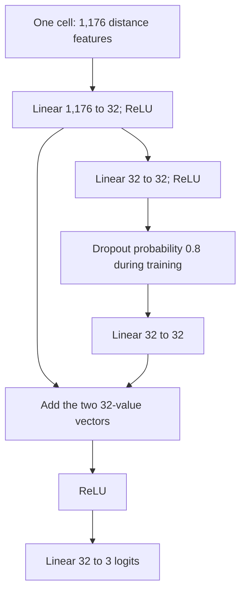

# 4. Experimental Requirements

## Step 1: Establish a Baseline

The baseline for Homework 3 is the final Homework 2 three-class residual multilayer
perceptron (MLP). Its recorded model version is
`hw2-three-class-residual-f1-seed42-v1`.

The shallow network created by `baseline_model()` was the comparison benchmark in
Homework 2. The final HW2 residual network is the starting point for HW3.

### Design diagram of the baseline architecture

[ResidualMLP](../../training/final_model.py) defines the stem, branch, addition and
output layer. The network contains 39,875 trainable parameters. Dropout is disabled
during evaluation. The predicted class is the index of the largest output logit.

### The dataset and prediction task

Predict Hepatocyte, Erythroblast or Proerythroblast from mouse chromosome 19 spatial
measurements. Labels remain outside the input features.

Training uses 2,439 eligible cells from biological replicates 1 and 2. Validation
uses 1,347 cells from replicate 3. The existing HW2 test has 1,458 cells from
replicate 4. Replicate 4 was used in earlier experiments and is a reused holdout.

The training-fitted mask retains 49 loci. Each trace supplies 49 × 48 ÷ 2 = 1,176
pairwise Euclidean distances. Distances are averaged over each cell's eligible
traces to produce one feature row per cell. Values are in micrometers, converted
to float32 and left unstandardized.

The cleaning protocol excludes cells with more than four raw traces and requires
at least 40 observed retained loci per passing trace. Missing coordinates are
linearly interpolated on the full locus-rank axis, with linear endpoint
extrapolation, before selecting the retained loci. Classes are selected using at
least 300 quality-passing training cells per named type. The same selected classes
are used for validation and test.

Definitions and saved settings:

- [Data readers](../../training/data.py)
- [Cleaning](../../training/cleaning.py)
- [Distance features](../../training/features.py)
- [Class selection](../../training/class_selection.py)
- [Frozen run settings](../../training/results/three_class_residual_f1_v1/run.json)

### Training procedure

The recorded run uses SGD without momentum, learning rate 0.01, shuffled batches
of 64 cells, seed 42 and CPU execution. The maximum budget is 2,000 epochs.
Epoch zero measures the initialized network. Training stops after 200 epochs
without a strict increase in validation macro F1.

The saved checkpoint maximizes validation macro F1, with lower validation loss
breaking equal-F1 ties. The selected epoch is 135. Training ended at epoch 335.

[fit_practice](../../training/final_model.py) implements this selection rule for
separate practice copies. The generic `fit_network` in
[train.py](../../training/train.py) selects by validation loss, so those entry
points have different checkpoint rules. The selected weights and their recorded settings are preserved in the frozen model folder.

### Training loss/objective

Cross-entropy is calculated from the raw logits and recorded target class indices.
SGD updates parameters to reduce this loss.

### Evaluation metric

Validation macro F1 selects the checkpoint. It averages the three per-class F1
scores with equal class weights. Accuracy and cross-entropy are also recorded.

| Split | Cross-entropy | Macro F1 | Accuracy |
| --- | ---: | ---: | ---: |
| Training | 0.739567 | 0.686825 | 69.37% |
| Validation | 1.094603 | 0.479058 | 49.81% |

The saved history begins at training loss 1.149029 before updates. Its reduction
and the above results provide evidence of learning. The gap between training and
validation performance requires interpretation. These observations alone do not
identify its cause.

### Verification on November 1, 2026

The frozen weights loaded successfully under Python 3.14.2 and PyTorch 2.11.0.
All seven frozen artifact hashes, six implementation hashes and five source-data
hashes matched their recorded identities. Rebuilding training and validation
inputs produced tensors of shape `(2439, 1176)` and `(1347, 1176)`.

Fresh evaluation of the frozen network reproduced the stored loss and macro F1
exactly. Accuracy differed only through floating-point rounding, by less than
0.00000002. The table above describes the selected saved weights. The full training
run was not repeated, and this verification did not read test replicate 4.

The following files connect the model to its recorded results:

- [History](../../training/results/three_class_residual_f1_v1/history.csv)
- [Training and validation metrics](../../training/results/three_class_residual_f1_v1/validation_metrics.json)
- [Frozen file identities](../../training/results/three_class_residual_f1_v1/freeze.json)

### Inspect the baseline

Read `ResidualMLP` in [final_model.py](../../training/final_model.py), then compare
its saved settings, metrics and history. The recorded baseline training and
frozen-weight checks establish the reference used for the HW3 comparison.
